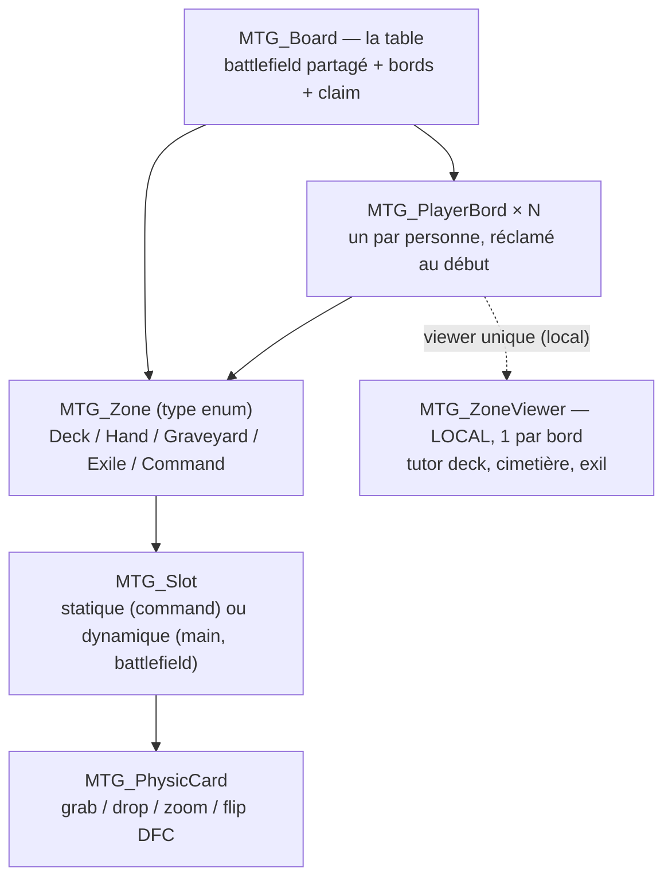

# 🃏 MTG – Architecture Board & Zones (v3)

> Récapitulatif complet de la logique du plateau et des zones.
> Complète le doc canonique « Logique d'interaction Zones.md » (philosophie).
> Les classes `MTG_DeckInterface`/`MTG_DeckCard` (création de decks, type Moxfield)
> et `MTG_SearchInterface`/`MTG_SearchCard` (recherche BDD, type Scryfall) sont
> **HORS** de ce système : elles servent aux interfaces, pas au plateau.
> Seul lien : au « Join » d'un bord, le deck **sélectionné dans la DeckInterface**
> est chargé dans la zone Deck du bord.

---

## 🎯 Philosophie (rappel)

- Le système **n'impose aucune règle de jeu** — le joueur applique les règles.
- Les zones **assistent** (modificateurs, ordre interne, actions assistées), elles ne bloquent jamais.
- Les cartes sont des **objets physiques grabbables**, ignorants des règles.
- La carte reste **maître de son état** : la zone demande, la carte applique.

---

## 🧠 Vocabulaire

| Terme | Définition |
|---|---|
| **Board / Table** | La table unique : battlefield partagé + N bords. |
| **Bord** | Côté de la table réclamé par un joueur (style untap.in). Contient ses 5 zones perso. |
| **Zone** | Volume + comportement (type enum). Gère modificateurs + ordre interne éventuel. |
| **Slot** | Ce qui tient une carte. Statique (ancre) ou dynamique (créé au drop / fan calculé). |
| **Carte** | Objet physique grabbable. 3 états d'affichage (voir §4). |
| **Viewer** | Zone d'affichage temporaire **locale** (fan-out), jamais réseautée. |

---

## 🧱 Hiérarchie

- **Battlefield** : une seule zone centrale partagée, attachée à la table, pas au bord.
- **Chaque bord** = `Deck` + `Hand` + `Graveyard` + `Exile` + `Command` (5 zones)
  + **1 viewer local unique** servant au tutor, au view cimetière et au view exil.
- **Les cartes peuvent passer d'un bord à l'autre** : zones ouvertes au drop manuel,
  jamais verrouillées par propriétaire. La privacy est gérée par l'affichage local, pas par le blocage.

---

## 📁 Classes et responsabilités

| Fichier | Rôle |
|---|---|
| `MTG_Board` | Références battlefield + bords, **claim des bords** (owner synced), actions cross-zone (draw, retour de viewer, spawn token). |
| `MTG_PlayerBord` | Groupe les 5 zones d'un joueur + `OwnerId` (réclamé au clic en début de partie). |
| `MTG_Zone` | Type (enum/int), modificateurs, `TryAcceptCard()` au drop, liste interne pour Deck/Graveyard/Exile. |
| `MTG_Slot` | Ancre/pose, occupant, stack (battlefield). |
| `MTG_ZoneViewer` | Viewer unique par bord (fan-out local) : tutor deck, view cimetière, view exil. |
| `MTG_PhysicCard` | À compléter : `CurrentZones[]`, `OnDrop` → notifie les zones, `SnapTo()`, état **caché**. |
| `MTG_Card` | Rien à toucher pour le flip (existe déjà). Seul ajout : l'état « caché » dans `UpdateFlipVisibility()` (déjà `virtual`). |

---

## 🂠 Les 3 états d'affichage d'une carte

1. **Normal** : face visible (front).
2. **Flip (DFC)** : uniquement pour les cartes double-face. **Déjà géré par la carte**
   (`FlipCard()`, bouton UI visible seulement si `IsDoubleFaced`). On n'y touche pas.
3. **Cachée (face down)** : nouvel état — la carte affiche son **dos**.
   Calcul **local par client**, dicté par la zone où est la carte :
   - main d'un bord adverse → **totalement masquée** pour les autres joueurs (ni face ni dos)
   - exil → dos pour tout le monde
   - deck (peek/draw si voulu) → dos
   - battlefield → visible (modificateur « morph » possible plus tard)

> Implémentation : surcharger `UpdateFlipVisibility()` dans `MTG_PhysicCard` :
> `caché ? dos : (IsFlipped ? back : front)`. Rien de synced — le client connaît
> l'owner de chaque bord (claim synced) et calcule tout lui-même.

---

## 🟩 Les 6 zones

### Battlefield (unique pour la table — validé)

- **Slots dynamiques illimités** — pas de grille. Au drop, la carte garde sa position avec snap :
  - loin d'une autre carte → pose libre (voir règles de rotation §6)
  - proche / chevauchement → **stack** sur la carte (même X/Z, Y = hauteur de pile)
- Grab ✓, zoom ✓, rotation libre (tap) ✓
- Prendre une carte d'une pile → les cartes du dessus redescendent
- **Tokens** : droppables n'importe quand (spawn via search → drop)
- Rien de nouveau à syncer : la carte sync déjà sa pose

### Deck (par bord, logique — jamais physique)

- **Chargement** : au « Join » d'un bord, le deck sélectionné dans la `DeckInterface`
  est chargé dans la liste.
- **Liste ordonnée de clés** (dessus = dernier index) + count, synced sur la zone.
- Opérations = opérations de liste :
  - **pioche[x]** → retire x du dessus → spawn physique dans la main
  - **tutor** → viewer du bord (owner uniquement) → sélection → clé retirée → spawn en main
  - **scry** → viewer local sur les N du dessus → renvoi dans l'ordre choisi (top/bottom)
  - **add to top / bottom** → insertion en tête / en queue
  - **shuffle** → Fisher-Yates
  - **peek** → 1 carte temporaire
- Drop d'une carte dessus → remise sur le dessus (absorption)
- Opérations **réservées au propriétaire du bord** (info cachée)
- ⚠ Une var synced est techniquement lisible par tous les clients — assumé pour une table casual.

### Hand (par bord) — un viewer continu

- **Taille variable, 1 à 30+ cartes**, pas de N fixe.
- Cartes **physiques** grabbables ; **fan = courbe (arc) paramétrée** : les slots de main
  sont posés le long de la courbe selon le count, et les cartes font un **lerp** vers leur
  position de slot (animation douce). Calcul local, aucune donnée réseau.
- Propriétaire : faces visibles, éventail devant son bord.
- Autres joueurs : cartes **forcées cachées** — ni face ni dos (masquage local par client,
  cf. §4). Le nombre de cartes en main n'est plus visible (compteur UI optionnel plus tard).
  ⚠ Implémentation : masquer renderer + pickup localement, en préservant la gestion pool
  (`OnDisable`/comptage) de la carte.
- Grab = sortir de la main (jouer/défausser) → le fan se recalcule immédiatement.
- Drop dans la main = ajout (carte re-fanée).

### Cimetière (par bord) — liste absorbée

- **Absorption** : drop → clé ajoutée sur le dessus (last on top, ordre conservé)
  + carte **détruite** (`ReturnToPool`).
- Liste synced sur la zone (info publique MTG), face visible.
- **View all** → viewer **local** (fan-out de N cartes physiques temporaires, sans réseau).
- **Sortie d'une carte** (reanimate etc.) → seul moment où elle redevient une carte réseau
  (spawn via pool). Tant qu'elle est au cimetière, on ne « load » rien.

### Exil (par bord) — comme le cimetière, face cachée

- Même mécanique : absorption, liste synced, ordonné, **last on top**, viewer local, sortie → spawn.
- Différence : affichage **face cachée** (dos) pour tout le monde.

### Command (par bord) — slot unique

- **1 slot statique** par bord.
- **Rempli au départ** : au setup, si le commander est identifiable dans la decklist,
  on le retire de la liste et on le pose dans le slot.
- Ensuite libre : on peut le poser / l'enlever physiquement.
- **Pas de retour automatique** (c'est au joueur de le faire).

---

## 🔄 Règles de rotation (battlefield)

La rotation n'est **pas stockée dans la zone** : elle dépend de qui pose la carte.

| Situation | Rotation appliquée |
|---|---|
| **Pose libre** (drop loin d'une autre carte) | La carte **fait face au joueur qui la lâche** (yaw = carte → tête du joueur, posée à plat). Deux joueurs posent au même endroit → deux orientations différentes. |
| **Snap sur une pile** | La carte **prend la rotation de la pile** (slot racine) pour rester alignée. |
| **Placements assistés** (draw → main, sortie de cimetière, commander au setup) | Face au **propriétaire du bord** (pas de drop physique). |
| **Après la pose** | Rotation **libre** (tap, tourner). L'orientation n'est appliquée qu'au drop/snap. |

- La **carte** applique sa rotation au drop (`OnDrop` → yaw vers le joueur local → sync de la pose,
  déjà le cas avec `_SyncedPosition/_SyncedRotation`).
- La zone ne fait que **proposer** la pose ; la carte l'applique.
- Conséquence assumée : attraper la carte d'un adversaire et la reposer la réoriente vers soi
  (comportement papier normal). Un modificateur `LockOrientation` est possible plus tard si besoin.

---

## 🪑 Claim des bords (untap.in style)

- **Bouton « Join » sur un bord libre** : attribue l'owner **et** charge le deck
  sélectionné dans la `DeckInterface` dans la zone Deck du bord.
- `OwnerId` synced sur le `MTG_PlayerBord` (ou tableau central sur `MTG_Board`).
- Un bord sans owner = neutre (quitter un bord : à prévoir plus tard).
- Les actions propres au bord (draw, scry, tutor, view) ne répondent qu'à son owner.
- Les déplacements physiques de cartes restent libres pour tous (passage inter-bords).

---

## 🌐 Réseau : sync vs local

| Donnée | Sync | Commentaire |
|---|---|---|
| Claim des bords | ✅ Board/PlayerBord, Manual | les clients en déduisent toute la privacy |
| Listes deck / cimetière / exil | ✅ Zone, Manual (`RequestSerialization` après chaque op) | clés = strings, count = int |
| Pose des cartes physiques | ✅ déjà fait (PhysicCard) | rien à ajouter pour le battlefield |
| Fan de la main (courbe + lerp) | ❌ local | calculé par count |
| Faces cachées (main adverse masquée, exil) | ❌ local | calcul client par bord |
| Viewer (view all, scry, tutor) | ❌ local | cartes temporaires non réseautées |

Contraintes Udon :

- Pas de référence GameObject en var synced → **clés string / indices int**.
- Les zones héritent de `MTG_Base` (zéro Update) → tout en **événementiel**
  (`OnDrop`, événements réseau, boutons).

---

## 🔁 Flux typiques

1. **Join bord → setup** : bouton Join → owner + chargement du deck choisi (DeckInterface)
   → identifier le commander dans la decklist → retirer de la liste → spawn dans le slot command.
2. **Draw 7** : 7× retrait du dessus → 7 spawns physiques dans la main → fan recalculé.
3. **Drop au cimetière** : `OnDrop` → la zone détecte la carte dans son volume →
   clé ajoutée sur le dessus → `ReturnToPool()` → sérialisation de la liste.
4. **View cimetière** : bouton → viewer local lit la liste synced → fan-out local →
   fermer = destruction locale, rien de réseau.
5. **Sortie du cimetière** : sélection dans le viewer → `SpawnPhysicCard(key, main/battlefield)`
   → clé retirée de la liste synced.
6. **Inter-bord / token** : grab + drop libre partout ; spawn de token via la search
   interface puis drop physique.

---

## ✅ Décisions validées (2026-09-23)

1. **Battlefield** : un seul pour la table, partagé entre tous les joueurs.
2. **Viewer** : un viewer **par bord**, unique — sert au tutor (deck), au view cimetière
   et au view exil.
3. **Main adverse** : les cartes de main des autres joueurs sont **forcées cachées**
   (ni face ni dos). Le nombre de cartes en main n'est plus visible (compteur UI optionnel plus tard).
4. **Claim** : bouton « Join » sur un bord libre → attribution de l'owner + chargement
   du deck sélectionné dans la `DeckInterface`.
5. **Fan** : les cartes sont posées sur une **courbe (arc)** via les slots ; les positions
   sont **lerpées** (animation douce vers le slot).

---

## 🛠 Ordre d'implémentation proposé

1. État « caché » (`MTG_Base`/`MTG_Card` : override de `UpdateFlipVisibility` côté `MTG_PhysicCard`)
2. `MTG_Slot` (statique + dynamique)
3. `MTG_Zone` (types, modificateurs, listes, snap)
4. `MTG_PlayerBord` (groupes de zones + owner)
5. `MTG_Board` (bords, claim, actions cross-zone)
6. `MTG_ZoneViewer` (fan-out local, 1 par bord)
7. Actions deck (draw, scry, tutor, shuffle, top/bottom, peek)
8. Claim/Join des bords + chargement du deck depuis `MTG_DeckInterface`
9. Fan de main : courbe (arc) + lerp des cartes vers leurs slots
